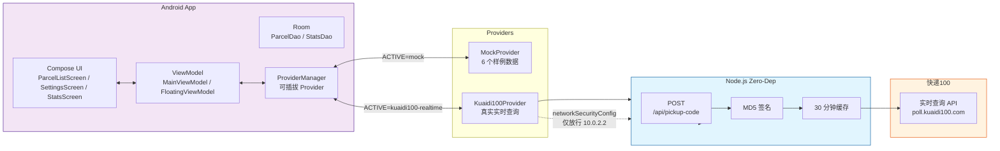

# 快递取件码浮窗助手（PickupHelper）


[](https://developer.android.com/)
[](https://kotlinlang.org/)
[](https://developer.android.com/compose)
[](LICENSE)

## 系统架构



## 技术栈

| **层** | **技术** | **说明** |
|---|---|---|
| App | Kotlin Jetpack Compose MVVM ViewModel | 原生 Android |
| 持久化 | Room DataStore | 本地数据库 + 设置存储 |
| 浮窗 | SYSTEM_ALERT_WINDOW | Android 桌面悬浮球 |
| 权限 | POST_NOTIFICATIONS (Android 13+) | 前台服务通知 |
| 网络安全 | networkSecurityConfig.xml | 仅 10.0.2.2 明文放行，不全局放开 |
| 后端 | Node.js 标准库 零依赖 | MD5 签名 + 30 分钟缓存防锁单 |
| 数据源 | 快递100 实时查询 / Mock | 可插拔 Provider |

## 真实性声明（面试如实陈述用）

本仓库对「真」与「演示」做了明确区分，方便如实讲解：

- [OK] **物流轨迹**：已用快递100 实时查询免费额度跑通**真实链路**（极兔单号 JT5533257831458，状态「已签收」，12 条轨迹），单测 26/26 全绿。
- [黄] **取件码**：目前为 **Mock**。取件码是快递100 独立预付费产品，账号未开通；架构已留 Kuaidi100Provider 占位，开通即接。
- [黄] **顺丰**：真实 API 强制收件手机号，示例未含真实单号，故**未实测**（不在简历谎称已测）。
- [锁] **密钥安全**：key/customer 仅在后端环境变量，App 端不持。

## 安全设计

- 密钥收敛到后端，链路为 App -> 后端 -> 快递100，App 永不见 key
- Android 9+ 明文 HTTP 经 res/xml/network_security_config.xml **仅放行 10.0.2.2**（模拟器回环），不全局放开
- 后端响应做 JsonNull 安全解析，避免缺字段导致客户端崩溃
- 曾于对话贴出的 key 建议**生产前在快递100 后台重置**

## 快速开始

### 后端（Node.js 零依赖，无需 npm install）

```bash
cd backend-node

# Windows PowerShell
$env:KUAIDI100_KEY = "你的KEY"
$env:KUAIDI100_CUSTOMER = "你的CUSTOMER"
node server.js
```

> 需提前在 [快递100 开放平台](https://www.kuaidi100.com/) 注册获取 key 与 customer。

### App（Android Studio / 模拟器）

1. 安装 APK：adb install -r app/build/outputs/apk/debug/app-debug.apk
2. 授权悬浮窗：adb shell pm grant com.pickuphelper android.permission.SYSTEM_ALERT_WINDOW
3. 打开 App -> 设置页 -> 填后端地址 http://10.0.2.2:8080 + 收件人手机号
4. 数据源切换至「真实API (Kuaidi100)」
5. 回到桌面 -> 点浮窗球 或 手动「+」录入单号

## 验证证据

- **单元测试**：./gradlew :app:testDebugUnitTest -> **26/26 通过**（含 fromChineseName 中文名->编码映射、用户手选 > 前缀推断的兜底优先级）
- **真实链路已签收**：work-package/test-screens/12_delivered_tab.png
- **失败分支按设计工作**：work-package/test-screens/test1_user_priority_failure.png

## 已知限制 / 路线图

- 取件码接入快递100 真实 API（需开通独立预付费产品）
- 顺丰真实链路实测（需真实单号 + 收件手机号）
- 多账号 / 多包裹批量查询
- 桌面 / 锁屏小组件

## License

MIT
